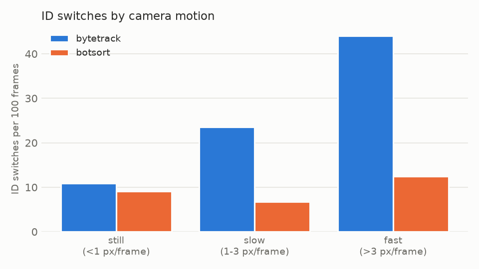
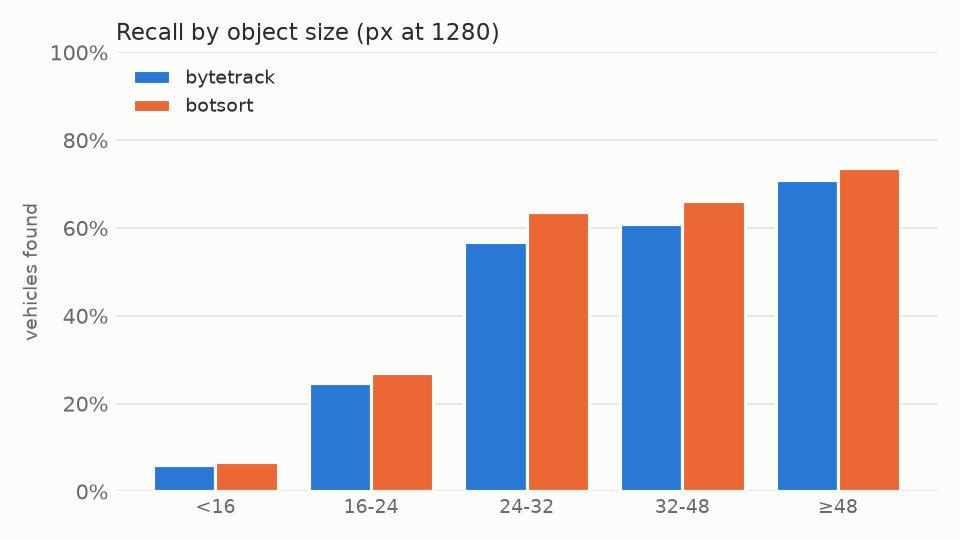
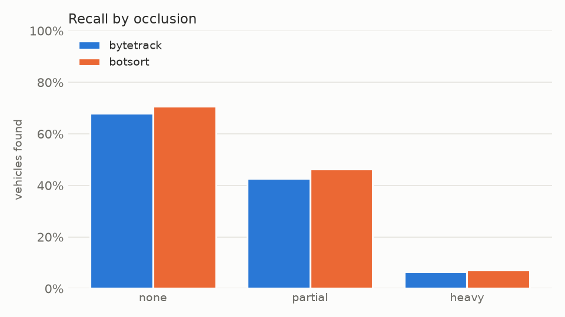

# Drone Vehicle Tracking

How well do off-the-shelf detectors and multi-object trackers follow vehicles in drone footage?
This project runs YOLO models combined with ByteTrack and BoT-SORT on the
[VisDrone-MOT](https://github.com/VisDrone/VisDrone-Dataset) benchmark and measures the results
against the ground truth.

> **Status:** work in progress. Baseline results with pretrained YOLO11s are below, fine-tuning follows.

<!-- Add a GIF of tracked vehicles here once the first run is done -->

## Questions

1. How much does tracking quality differ between ByteTrack and BoT-SORT on aerial traffic scenes?
2. Detectors pretrained on COCO mostly see vehicles from street level. How much do they lose on top-down views, and how much does fine-tuning on drone data recover?
3. Where do the trackers fail (dense traffic, occlusion by trucks or trees, small objects)?

## Setup

Tested on macOS with Apple Silicon (PyTorch uses the GPU via MPS). Linux with CUDA works as well.
You need Python 3.10 or newer. The Python 3.9 that ships with macOS is too old for current PyTorch.

```bash
python3 -m venv .venv
source .venv/bin/activate
pip install -r requirements.txt
```

With [uv](https://docs.astral.sh/uv/) you can get a suitable Python in one go:

```bash
uv venv --python 3.12 .venv
uv pip install --python .venv/bin/python -r requirements.txt
```

## Data

Download the **VisDrone2019-MOT validation set** (about 1.5 GB) from the
[official repository](https://github.com/VisDrone/VisDrone-Dataset) and unpack it into `data/`:

```
data/VisDrone2019-MOT-val/
    sequences/<sequence>/0000001.jpg ...
    annotations/<sequence>.txt
```

The dataset is not part of this repository (its license does not allow redistribution).
Only the four-wheeled vehicle classes are used: car, van, truck and bus.

## Usage

```bash
# 1. Overview of the sequences and object counts
python inspect_data.py --data-root data/VisDrone2019-MOT-val

# 2. Render the ground truth of one sequence as a video (sanity check)
python render_ground_truth.py --data-root data/VisDrone2019-MOT-val --seq <sequence>

# 3. Quick test on 100 frames of one sequence
python run_tracking.py --data-root data/VisDrone2019-MOT-val --seq <sequence> --max-frames 100 --save-video

# 4. Full runs with both trackers
python run_tracking.py --data-root data/VisDrone2019-MOT-val --tracker bytetrack.yaml
python run_tracking.py --data-root data/VisDrone2019-MOT-val --tracker botsort.yaml

# 5. Score both runs with TrackEval (HOTA, MOTA, IDF1)
python evaluate.py --data-root data/VisDrone2019-MOT-val --runs yolo11s_bytetrack yolo11s_botsort

# 6. Break the errors down by object size, occlusion and camera motion
python analyze_errors.py --data-root data/VisDrone2019-MOT-val --runs yolo11s_bytetrack yolo11s_botsort
```

Tracker output is written in MOTChallenge format to `results/<run>/tracks/` and scored with
[TrackEval](https://github.com/JonathonLuiten/TrackEval).

## Project structure

```
tracking/
    visdrone.py      reading sequences and annotations
    mot_format.py    writing tracker output for evaluation
    drawing.py       boxes, track IDs, video export
    evaluation.py    ground truth conversion, distractors and ignored regions for TrackEval
    analysis.py      matching, ID switch events, camera motion
inspect_data.py      dataset overview
render_ground_truth.py
run_tracking.py      detector + tracker over all sequences
evaluate.py          TrackEval scores per run
analyze_errors.py    error breakdown and charts
```

## Roadmap

- [x] Data loading and ground-truth visualization
- [x] Tracking pipeline with ByteTrack and BoT-SORT
- [x] Evaluation with TrackEval (HOTA, MOTA, IDF1)
- [x] Comparison of ByteTrack and BoT-SORT
- [x] Failure analysis (object size, occlusion, camera motion)
- [x] Larger input size for small objects
- [ ] Tiled inference
- [ ] Fine-tuning the detector on VisDrone-DET

## Results

Baseline: YOLO11s pretrained on COCO, input size 1280, default tracker settings of Ultralytics.
Evaluated on the six VisDrone2019-MOT validation sequences that contain vehicles
(uav0000086_00000_v has none and is skipped), about 40,000 vehicle boxes in total.

| Tracker | HOTA | DetA | AssA | MOTA | IDF1 | ID switches | FP | FN |
|---|---|---|---|---|---|---|---|---|
| ByteTrack | 44.9 | 36.4 | 56.7 | 37.1 | 52.0 | 423 | 4,759 | 20,145 |
| BoT-SORT | **50.8** | **38.6** | **67.9** | **39.0** | **60.5** | **233** | 5,377 | **18,955** |

### How the evaluation treats VisDrone

Car, van, truck and bus are merged into one vehicle class, since COCO has no van and
there are only 11 trucks and buses in the whole split. Tricycles and the "others" category
look a lot like small vehicles, so a box on one of them is removed instead of being
counted as a false positive. This is the same distractor rule MOTChallenge uses.
Boxes that lie at least half inside an ignored region are dropped before scoring,
as in the official VisDrone toolkit.

### BoT-SORT keeps identities when the drone moves

Both trackers get the same detections, so detection accuracy (DetA) is almost equal.
The gap is in association: BoT-SORT has 45% fewer ID switches. The reason shows up once
the switches are split by how much the whole image moves between frames.

<picture>
  <source media="(prefers-color-scheme: dark)" srcset="docs/figures/switches_by_motion_dark.png">
  
</picture>

With a still camera both trackers behave about the same. When the drone pans, ByteTrack
loses track much more often (44 vs. 12.5 switches per 100 frames). Both trackers predict
each box with a constant velocity Kalman filter, but a panning camera moves every object in
the image at once and the prediction lands next to the vehicle. BoT-SORT estimates this
global motion with sparse optical flow and corrects its predictions, ByteTrack does not.

### The detector is the bottleneck

Almost half of all vehicles are never detected. When YOLO does fire it is mostly right
(precision around 80%), so the problem is recall.

<picture>
  <source media="(prefers-color-scheme: dark)" srcset="docs/figures/recall_by_size_dark.png">
  
</picture>

Size matters most. Vehicles smaller than 24 px at inference size make up 27% of the
ground truth, and fewer than one in four of them is found. In the 4K sequence
uav0000268_05773_v the image is shrunk by a factor of three before detection, and recall
drops to 25%. Occlusion has a similar effect: 71% of fully visible vehicles are found,
46% of partly occluded ones and only 7% of heavily occluded ones.

<picture>
  <source media="(prefers-color-scheme: dark)" srcset="docs/figures/recall_by_occlusion_dark.png">
  
</picture>

Viewpoint is the other big factor. uav0000305_00000_v is filmed straight down, and even
though the cars there are large (median width over 60 px), only 18% of them are detected.
A COCO model has hardly seen a car roof. The vehicles it does pick up in that sequence sit at
the image border, where they are seen slightly from the side.

One more detector effect: a van seen at an angle is sometimes detected as the whole vehicle
and sometimes only as its front. Both boxes overlap the ground truth enough to count, so
the two competing tracks cause most of the ID switches in the otherwise easy sequence
uav0000268_05773_v, for both trackers alike.

### Larger input size helps small vehicles, but not the top-down view

Running BoT-SORT with `--imgsz 1920` instead of 1280 gives the detector 1.5 times more pixels
per object.

| Input size | HOTA | DetA | AssA | MOTA | IDF1 | ID switches | FP | FN | FPS |
|---|---|---|---|---|---|---|---|---|---|
| 1280 | 50.8 | 38.6 | **67.9** | **39.0** | 60.5 | **233** | **5,377** | 18,955 | 11 to 28 |
| 1920 | **51.6** | **40.9** | 66.5 | 38.2 | **62.3** | 257 | 8,668 | **15,959** | 12 to 15 |

Recall for vehicles under 16 px (measured at 1280) jumps from 5% to 35%, and recall in the
4K sequence rises from 25% to 39%. But the detector also produces 60% more false positives,
so MOTA even drops a little and HOTA only gains 0.8 points. The top-down sequence
uav0000305_00000_v does not improve at all (18% to 16%), which supports the idea that the
problem there is the viewpoint and not the object size.

These findings point to the next step: fine-tuning on drone images.

## License

AGPL-3.0, since the project builds on Ultralytics, which is licensed under AGPL-3.0.
The VisDrone data has its own non-commercial license and is not included.

## Acknowledgements

- Dataset: Zhu et al., *Detection and Tracking Meet Drones Challenge*, IEEE TPAMI 2021 ([VisDrone](https://github.com/VisDrone/VisDrone-Dataset))
- Detection and tracking: [Ultralytics](https://github.com/ultralytics/ultralytics), which implements [ByteTrack](https://github.com/ifzhang/ByteTrack) and [BoT-SORT](https://github.com/NirAharon/BoT-SORT)
